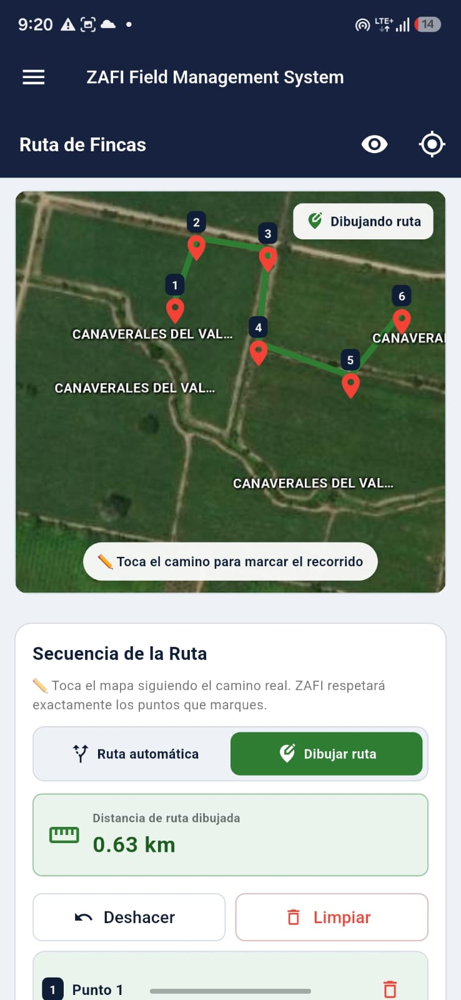
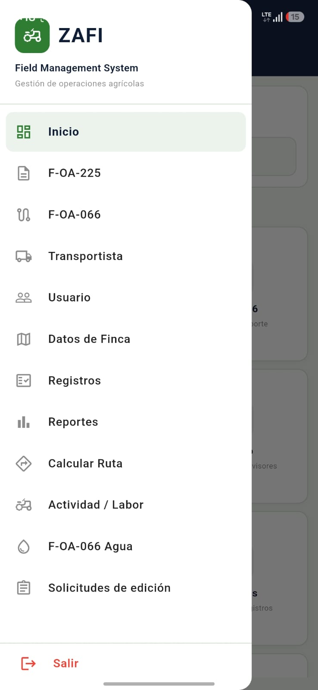
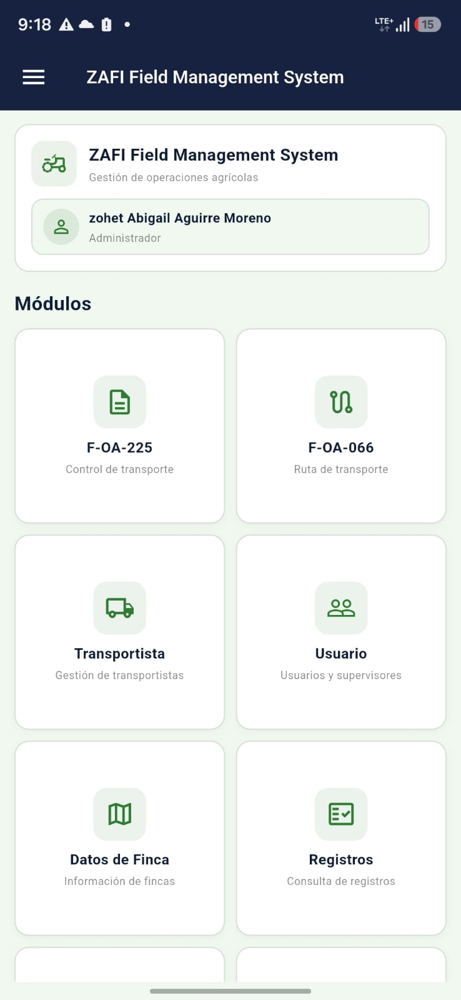
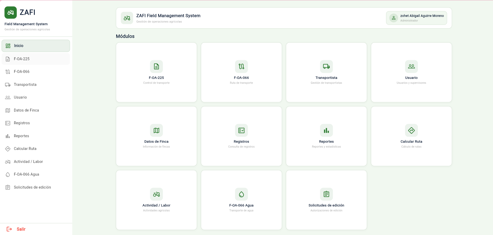
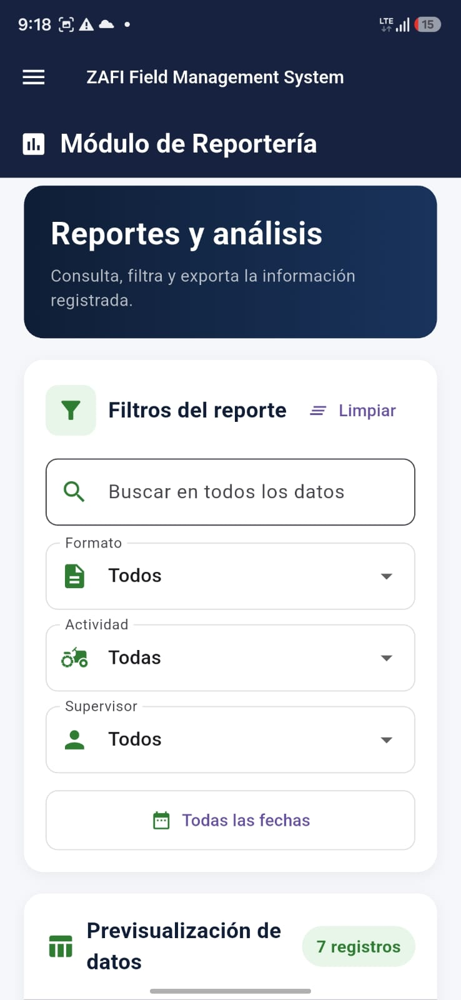

# Sistema de Gestión de Transporte y Kilometraje

Aplicación móvil desarrollada con **Flutter y Dart** para digitalizar la gestión de formatos de transporte, reducir reprocesos administrativos y optimizar el cálculo de kilometraje entre fincas.

## Descripción del proyecto

El proyecto surge de la necesidad de reducir los reprocesos ocasionados por errores en formatos físicos, que obligaban a los supervisores a regresar al ingenio para realizar correcciones.

La aplicación digitaliza el flujo de gestión de la información, desde la generación del pago hasta su finalización, e incorpora herramientas para administrar formatos de transporte y calcular distancias entre fincas mediante coordenadas geográficas.

## Funcionalidades principales

- **Gestión de formatos:** registro de proveedores, subcontratistas y transportistas para el transporte de insumos agrícolas y agua potable.
- **Cálculo de kilometraje:** visualización de fincas en un mapa y cálculo de distancias entre puntos seleccionados.
- **Gestión de rutas:** selección de puntos mediante búsqueda o selección manual para construir recorridos.
- **Carga de fincas:** importación de archivos KML para identificar ubicaciones mediante coordenadas geográficas.
- **Gestión de usuarios y roles:** administración de permisos y accesos a los diferentes módulos.
- **Administración de datos:** operaciones de creación, consulta, actualización y eliminación de registros (CRUD).

## Tecnologías utilizadas

- Flutter
- Dart
- Mapas y coordenadas geográficas
- Archivos KML
- Git y GitHub

## Capturas de pantalla

### Mapa y cálculo de kilometraje

### Gestión de módulos

### Administración de módulos

### Funcionalidades adicionales

### Reportes de la aplicación

---

**Objetivo del proyecto:** aplicar el desarrollo móvil para optimizar procesos administrativos y logísticos mediante la digitalización de información, la gestión de rutas y el cálculo de distancias.
